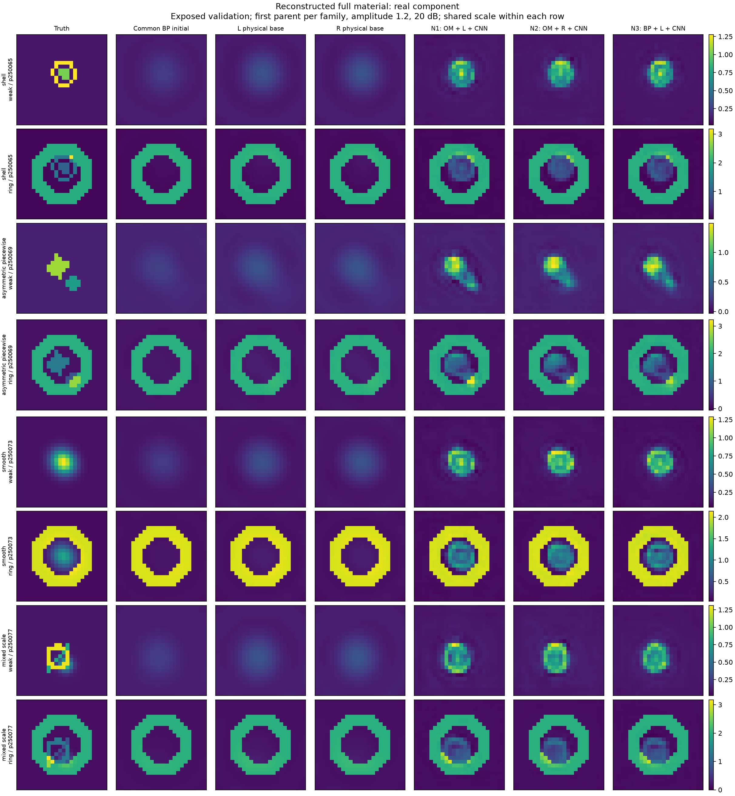
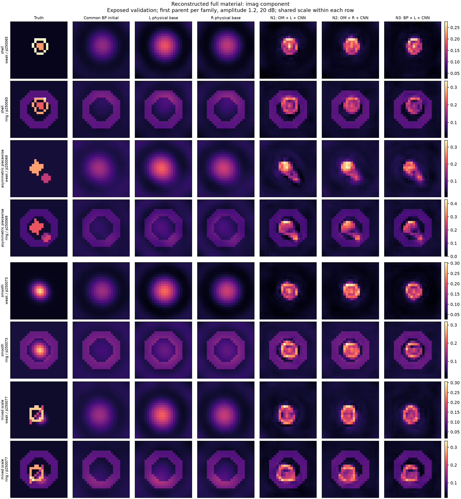

# A26 复杂材料的真实训练成像结果

CNN 结构先验在复杂三家族中改善各自物理初值约 23%–24%，但剩余材料误差仍很大。下面的数字先平均每 parent 的八个背景/幅度/噪声条件，再等权汇总；重复观测不是独立对象。

| 家族 | N1 | N2 | N3 | 无 NN L/BP | 无 NN R |
| --- | --- | --- | --- | --- | --- |
| shell | 0.65244 | 0.666504 | 0.663366 | 0.876932 | 0.875598 |
| asymmetric_piecewise | 0.737577 | 0.727957 | 0.73834 | 0.903903 | 0.90311 |
| smooth | 0.38703 | 0.371062 | 0.397701 | 0.765972 | 0.763982 |
| mixed_scale | 0.6263 | 0.62552 | 0.614959 | 0.858037 | 0.856743 |

| 配对（复杂三家族） | 改善 % | 区间下限 % | 区间上限 % |
| --- | --- | --- | --- |
| N2_vs_N1 | -0.22497 | -2.45492 | 2.01316 |
| N2_vs_N3 | -0.273442 | -1.61211 | 1.24648 |
| N1_vs_N3 | -0.207612 | -2.89103 | 2.39157 |
| N1_vs_BASE_N1 | 23.6612 | 18.4534 | 28.3248 |
| N2_vs_BASE_N2 | 23.4423 | 18.6957 | 28.2992 |
| N3_vs_BASE_N3 | 23.6931 | 18.9957 | 28.7902 |

每家族四个独立 parent，复杂主比较共十二个。2000 次 paired parent bootstrap 是开发证据，不是盲测确认。完整 χ、SSIM、IoU、edge、实虚部和 full Maxwell 残差见 [逐 parent 表](results/a26/evaluation/261009/PER_PARENT_METRICS.csv) 与 [全部条件](results/a26/evaluation/261009/PER_CASE_METRICS.csv)。support 阈值为离线真值增量最大幅度的 25%，仅用于评估；edge 为四邻域边界的精确像素 F1，无匹配容忍度。passivity 与 box 可行性来自输出投影，不构成唯一恢复证据。

N1 与 N3 的无 NN 材料输出完全相同：两者使用相同 L 更新，差异仅在 OM/BP 可观测特征。N2 使用一次 TASK_R32 更新。A25 缓存 TV 初值仅是额外离线参考；它不是完整 TV 成像轨迹，更不是 SOM-Net 官方基线。

所有推断限于已知背景、二维 TM 24×24、固定复相位材料增量与已暴露开发验证。只有一个训练 seed、一个训练规模和一种 CNN 深度；不支持独立泛化、任意复材料、3D、样本效率或层数减少结论。
