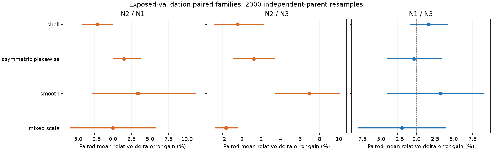
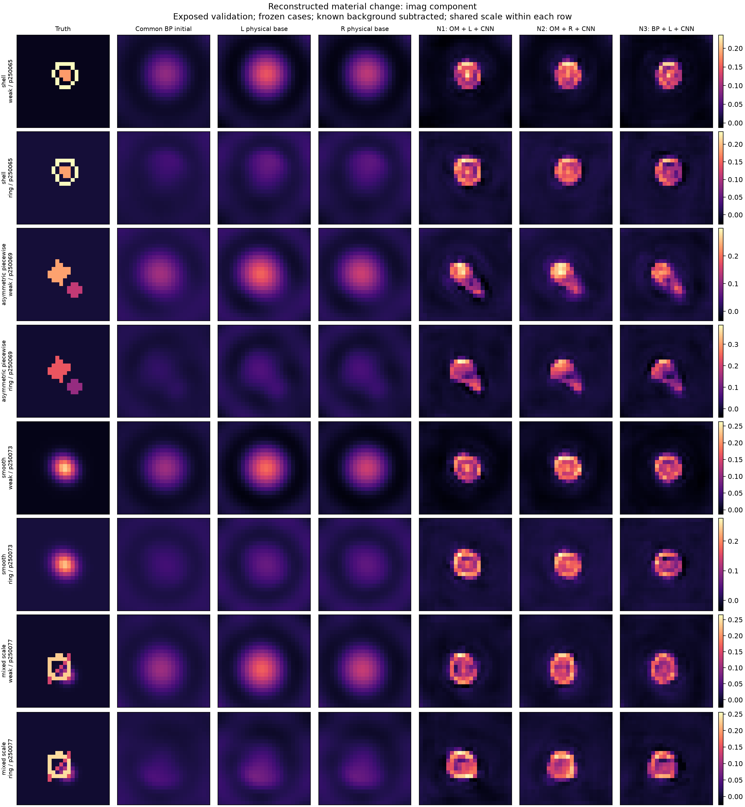
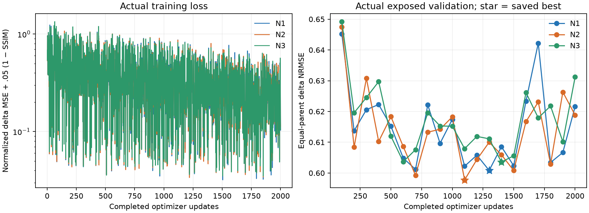

# A26 中文研究报告：OM 物理编码、显式反馈与轻量结构先验

## 背景与研究问题

逆散射材料成像同时受测量可识别性和结构歧义约束。物理求解器能够把一个材料假设映射为散射数据，却不保证有限视角、噪声下的反问题唯一；CNN 可以补充形状先验，也可能生成数据未充分支持的边界。实际目标是用相同信息与参数预算判断物理表示是否减少必须交给先验的结构误差，并计量从原始测量到图像的完整耗时。

[SOM-Net 原论文](https://arxiv.org/abs/2209.03567) 将确定性诱导电流和 backpropagation 材料估计输入学习流程，通过展开 SOM 更新与物理一致性约束构造网络。这里借鉴物理表示与材料更新思路，研究一个更小的冻结 encoder + 五层 residual CNN。没有训练官方 SOM-Net 或忠实 N0，因此不声称优于 SOM-Net。源、材料、背景和传播资产来自 [冻结 A25 报告](https://github.com/migodam/a25-adaptive-om-feedback/blob/59d8cc57c9da99ccb7978febc308193c43d6f3e5/A25_RESEARCH_REPORT_ZH.md)，其失败与 HOLD 结论没有被覆盖。

核心问题是：显式 Maxwell feedback 是否提供对复杂材料有用、且抵得过其实际计算成本的初始化/特征，减轻轻量先验的结构恢复任务？

## 实际完成与结论

三个模型各完成 **2000 次真实优化更新**，每个 **31,810 参数**，共 6000 次主训练更新；best/middle/final checkpoint 全部保存。使用 XINAN RTX 4060 Laptop/8GB。128 个开发观测（16 parents）上的全部配对完整、数值失败为零；独立 predicted-state 物理精度不足仍单独保留。没有新增真值标签，没有读取 locked ID/OOD。

CNN 先验对三个无 NN 初值都有效，但 OM 的专门特征和一次显式反馈未在复杂材料中建立独立增量。N2 完整 warm 推理约为更快对照的 **3.274 倍**。冻结开发扩展门槛 **NO_GO**，停止第二 seed 和 locked 扩展。总体 Δχ NRMSE 仍约 60%，asymmetric 约 73%–74%，不能把较好看的图像当成精确或唯一恢复。

## 物理模型、坐标和信息边界

复用 A24 已验证的二维 TM 标量 VIE 后端；没有修改 Maxwell solver、Green、本构或 receiver。材料为完整 24×24 复网格；实质量坐标为 `[Re576, Im576]×sqrt(cell area)`，cell area=1/576，因此共 1152 维。8 sources/32 receivers 的数据逐源 `[Re32, Im32]`，共 512 维实数据。物理计算 complex128/float64，CNN float32。所有 sources 对应同一个材料图。

已知背景下，令 h=χ−χ_b，e_b 为背景场，G_b 为背景传播，D_b 为背景至接收数据映射。材料相对电流满足 w=diag(h)(e_b+G_b w)，数据增量为 D_b w。L 忽略新增 relative feedback，用 w=diag(h)e_b；R 使用冻结 TASK_R32 的 Woodbury closure。该相对表达是解析模型结构，不自动保证压缩准确或成像收益。

共同初值由背景 material adjoint 和保存的背景谱步长构造后投影到 box。N1/N3 再用同一个 L 梯度做一次材料更新；N2 用 R 梯度替代。OM 观测特征由 **D_b** 的 rank16 截断 SVD 构造；N3 使用普通背景 BP/adjoint 特征。M 和反馈只由共同在线初值驱动，未知 χ、truth-state J、full GN、teacher currents 从不进入 encoder。背景 J 合法，因为 χ_b 已知，并独立核对其算子与真实 mass/packing。

12 个匹配通道包括材料初值实虚部、OM/BP 观测实虚部、残差梯度实虚部、跨源场/激发功率、背景实虚部和 confidence 对角图。软 confidence 来自已知背景 Jacobian 谱，权重 s²/(s²+(.05s_max)²)。复 Gaussian 噪声的实虚方差为 σ²/2，白化比例 sqrt(2)/σ；该相对谱阈值中尺度消去。无噪声另用背景尺度归一化。它是数值稳定性指标，不是物理 recoverability 证书。主 CNN 可以修正整个网格，没有强制弱空间投影，也没有 decoder 后物理更新。

在线读取测量、已知背景、几何和噪声；trainer 独立读取标签。NPZ 真实路径、split、parent 白名单在数值 payload 前验证，混合/伪装 locked 数据拒读。发布复现包仅含 train/已暴露 validation，不含未打开的 locked payload。

## 训练、公平性和预算冻结

64 train parents，16 validation parents，四家族等量；每 parent 两背景×两幅度×clean/20dB，共 512/128 观测。重复条件没有跨 split。现有标签的增量具有固定复相位，不能推广到独立变化的任意实/虚材料。没有新数据 campaign。

三个 CNN 同为五层、宽32、dilation=1/2/4/2/1、GELU、零初始化输出头；输入均12通道，输出共同材料残差再执行 Reχ∈[-.5,4]、Imχ∈[0,.5] box。共享 train-only pooled 归一化、初始权重、parent 采样顺序和材料 RMS。每 batch 四家族各一个 parent，循环全部观测。

AdamW lr=.001、weight decay=1e−5、gradient clip=1，seed261009；loss 为归一化材料 MSE + .05×(1−SSIM)。物理 encoder 冻结并预缓存，训练 loss 没有每臂不同的物理模型项。每100更新用16个 parent 等权 Δχ NRMSE 验证并选 best，middle 为1000步，另保存 final。真实缓存 microbenchmark 在 1.3 成本余量及评估/报告预留下选择2000更新；microbenchmark 权重/optimizer 丢弃重置。更新数只按成本选择，未按质量调长训练。

6000 次 decoder backward 不调用物理算子、LU 或 feedback。实际 training manifest、cache-only code、接受账本的6000 backward spans，以及将 Maxwell/encoder 入口替换为失败的可执行测试共同支持这一点。原 native receipt 没有显式 physical-zero 键，保持原样；不事后改账本补造零计数。新图仍需重算 encoder，cached decoder 时间不能冒充部署 latency。

## 材料成像与先验收益

| 家族 | N1 | N2 | N3 | 无 NN L/BP | 无 NN R |
| --- | --- | --- | --- | --- | --- |
| shell | 0.65244 | 0.666504 | 0.663366 | 0.876932 | 0.875598 |
| asymmetric_piecewise | 0.737577 | 0.727957 | 0.73834 | 0.903903 | 0.90311 |
| smooth | 0.38703 | 0.371062 | 0.397701 | 0.765972 | 0.763982 |
| mixed_scale | 0.6263 | 0.62552 | 0.614959 | 0.858037 | 0.856743 |

| 配对（复杂三家族） | 改善 % | 区间下限 % | 区间上限 % |
| --- | --- | --- | --- |
| N2_vs_N1 | -0.22497 | -2.45492 | 2.01316 |
| N2_vs_N3 | -0.273442 | -1.61211 | 1.24648 |
| N1_vs_N3 | -0.207612 | -2.89103 | 2.39157 |
| N1_vs_BASE_N1 | 23.6612 | 18.4534 | 28.3248 |
| N2_vs_BASE_N2 | 23.4423 | 18.6957 | 28.2992 |
| N3_vs_BASE_N3 | 23.6931 | 18.9957 | 28.7902 |

正改善定义为 `(对照误差−候选误差)/对照误差`，先平均每 parent 内八条件，再平均 parent 配对改善。bootstrap 2000 次重采样独立 parent；复杂主门槛只包括 shell/asymmetric/mixed-scale，共12 parents。四个 smooth parents 单独公开，没有用它们替代复杂材料门槛。因为验证集已暴露且用于 checkpoint 选择，区间只描述开发稳定性。

N1/N2/N3 相对自身物理初值改善约 23%–24%，H1 有开发证据。N1 对 BP N3 没有复杂结构优势，H2 未建立。N2 对两对照的复杂增量略为负且区间跨零，H3 未建立；完整数据残差分别恶化约7.85%/8.99%，也未通过非劣门槛。所有图像与失败都计入，没有 success-only 筛选。

N1 与 N3 的无 NN 材料输出完全相同：两者使用相同 L 更新，差异仅在 OM/BP 可观测特征。N2 使用一次 TASK_R32 更新。A25 缓存 TV 初值仅是额外离线参考；它不是完整 TV 成像轨迹，更不是 SOM-Net 官方基线。

图像固定为每家族首个 validation parent、两背景、高幅度、20dB；不是根据效果选择的对象。图中已经减去已知背景，同时公开完整 χ 图。直接目视审核发现：首个 shell 的内部空腔在三个 CNN 中均被部分填平；首个 smooth 的 ring-background 预测呈环状中心空缺，而真值是实心平滑峰；asymmetric 的离散边界与小部件被模糊。这些例子显示结构先验同时改善定位和引入偏置，不能将好看的轮廓认作真值认证。实部、虚部使用同一行共享色标，完整数组和误差图公开。剩余结构主要仍依赖学习分布，不能声称唯一恢复。

完整指标还包括 fullχ/Δχ NRMSE、SSIM、support IoU、四邻域 edge F1、实虚部误差、passivity、完整 nonlinear Maxwell data residual。详细逐条件 CSV 与逐 parent 表均可复算；fullχ 误差可能被较大的已知 ring 背景稀释，主指标始终是 Δχ。

## Feedback 精度与噪声机制

| 状态 | 审核数 | 旧任务精度门槛通过数 | 最小梯度 cosine | 最大 JVP 误差 | 最大 adjoint 误差 | 最大有限更新误差 |
| --- | --- | --- | --- | --- | --- | --- |
| INITIAL | 16 | 16 | 0.999984 | 0.00402203 | 0.00384756 | 0.00585855 |
| MIDDLE | 48 | 37 | 0.950109 | 0.0236037 | 0.0262011 | 0.327039 |
| FINAL | 48 | 42 | 0.947365 | 0.0261498 | 0.0272661 | 0.375205 |

16 个固定代表条件在共同初值处审核；三个模型各自1000步/最终预测上再做96次独立 full 物理审核。JVP/VJP 比较使用预冻结独立随机方向，core与full backward residual 都留档。TASK_R32 初始化审核通过，但较晚 predicted states 的最小梯度 cosine 约 .95，有限 box 更新可偏差约33%–38%。这些精度不足没有被 hidden jitter、伪逆、full fallback 或删除对象掩盖。

主 encoder 固定在初值，因此 learned-state 风险不能解释为该主训练每一步都用了坏梯度。它否决的是未经新验证就把 TASK_R32 扩展成 learned-state recurrence 的假设。解析伴随配对通过与压缩模型对完整物理准确是两个不同判断。

| 在线分组 | 配对 | 观测数 | parent 数 | 平均 parent 改善 % |
| --- | --- | --- | --- | --- |
| NOISE_FREE | N2_vs_N1 | 64 | 16 | -0.200913 |
| NOISE_FREE | N2_vs_N3 | 64 | 16 | 1.52775 |
| FEEDBACK_GE_NOISE | N2_vs_N1 | 0 | 0 | NOT_RECORDED |
| FEEDBACK_GE_NOISE | N2_vs_N3 | 0 | 0 | NOT_RECORDED |
| FEEDBACK_LT_NOISE | N2_vs_N1 | 64 | 16 | -0.0584551 |
| FEEDBACK_LT_NOISE | N2_vs_N3 | 64 | 16 | 0.979747 |

64个带噪观测的在线 beta 全部小于1，范围 0.0283473–0.96382，中位数 0.168626。因此本实验没有 FEEDBACK_GE_NOISE 样本，H4的高/低信噪对比不可识别；不能宣称已经验证或否定高反馈信号 regime。共同廉价初值的材料激发较弱，是一个待检验的限制，不能用事后新增强激发对象改变本次主结果。

H4 的 beta 只使用在线预测 R−L 数据差和已知噪声，clean 单独列出。这是输入分布限制，不用它事后改变 gates。

## 从原始测量到材料图像的完整成本

| 方法 | 完整 warm ms | encoder ms | CNN+box ms | 含独立 full 审核 ms | 新进程首图 s |
| --- | --- | --- | --- | --- | --- |
| N1 | 40.8274 | 25.4894 | 13.6837 | 195.071 | 4.1932 |
| N2 | 126.084 | 114.671 | 13.3921 | 281.075 | 3.83227 |
| N3 | 38.5077 | 23.5162 | 13.9021 | 194.753 | 3.13385 |

每方法48次完整 resident warm 图像计时，包含 encoder、搬运、CNN、box 与输出转移；三个方法轮换顺序、每图材料状态重置。另保留强制逐算子日志的 instrumented 计时、完整独立 full 审核成本、fresh encoder/checkpoint 成本、新 Python 进程首图成本。操作系统磁盘缓存未控制，不能称 disk-cold benchmark。fresh-process 各臂只有一次，不用它声称显著提速。

N2 大部分额外时间花在物理 encoder。新图 TASK_R32 closure、paired adjoint、core assembly/solve 都真实执行，并计数；rank32或少参数不等于完整提速。N2 warm约126ms，而两个对照约39–41ms，质量没有补偿，因此 H5 失败。完整在线算子逐次账本与统计在 ONLINE_ACTION_SUMMARY.json；不同嵌套 counter 有重叠，不相加伪造总 action。

## 数值测试、失败与费用

最终回归测试记录：135项运行，0 errors、0 failures；skipped=3，旧独立 Clarabel 测试因远端缺少该可选依赖跳过。保留 A24/A25 原测试及新增数据读取前隔离、background packing/adjoint、源置换、cache、预算、checkpoint、相同参数/采样、metrics 与禁止 backward 调物理入口测试。

运行故障包括早期选择无 NumPy 的本地解释器、测试 active-ledger 包装缺失、source deploy 缺少根配置、CUDA deterministic CuBLAS workspace 缺失，以及一次 N3 新进程在 Python json 启动处异常。均留账后修复入口或在不变配置下必要重跑；沒有修改数学容差、关闭确定性或按失败删除材料对象。物理 task 精度失败与系统失败分别记录。测试通过、物理代数恒等式正确和发布成功均不构成算法优势。

报告生成前已接受预算费用：CPU 1094.788s，GPU occupation 929.700s。报告/图表/发布后续工作继续单独计费；终端 receipts、COST_LEDGER 和 A26_COST_AND_RUNTIME.md 的显式 cutoff 是权威，不能将本段前置 snapshot 当最终总计。CPU cap7200s、GPU cap14400s；GPU host CPU 另计，旧 A25 费用只作为历史来源、不重复扣费。新增 labels=0。

## Gates、证据分层与下一步

开发扩展门槛保持冻结：复杂材料改善≥10%且bootstrap支持正方向、至少两复杂家族改善、任一家族恶化≤5%、完整数据残差恶化≤5%、N2 warm≤快对照1.25倍、配对完整且数值有效。主 gate 为 **NO_GO**。冻结扩展门槛 NO_GO。第二 seed、locked ID/OOD、额外架构搜索、soft weak-space 消融、decoder 后物理修正均 NOT_RUN；locked cohort 未消费。

| 证据层 | 已得到的证据 | 不支持的结论 |
| --- | --- | --- |
| 解析模型 | background-relative Maxwell identity、paired derivative/adjoint | OM 名称不证明成像优越 |
| 数值/unit | packing、known-bg J、源置换、core/residual、缓存与隔离测试 | tiny/tests 不等于真实材料收益 |
| 实际二维 Maxwell + NN | 三模型真实训练、完整开发配对、图像、预测态 full 审核 | 不推广到3D、独立测试或任意复相位 |
| Oracle/offline | 标签仅用于监督/评估，full solver 仅在预测材料处独立审核 | 不作为 online feature 或免费部署成本 |
| 部署 | 原始测量→图像完整计时和 actions | cached CNN、rank、参数量不能代替 time-to-image |

H1支持，H2/H3未建立，H4因缺少高 beta 组而不可识别，H5负向；最终 **NO_GO 当前反馈扩展**。较简单 BP + CNN 获得相似先验收益与更低成本，值得下一实验独立验证。不能宣称一般 Maxwell feedback 无用：这里测试的是固定 TASK_R32、共同一次物理更新、一个小 CNN/seed/已暴露分布。也不能自动进入更大 NN、更多 rank、SOM/3D/locked campaign。

## 公开证据与复现

[仓库](https://github.com/migodam/a26-om-feedback-prior-completion) · [研究报告](https://github.com/migodam/a26-om-feedback-prior-completion/blob/main/A26_RESEARCH_REPORT_ZH.md) · [匿名 raw](https://raw.githubusercontent.com/migodam/a26-om-feedback-prior-completion/main/A26_RESEARCH_REPORT_ZH.md) · [Release](https://github.com/migodam/a26-om-feedback-prior-completion/releases/tag/a26-v0.1.0)。实际发布状态由 PUBLICATION_STATUS.json 和 release target commit 独立核验。

配置、源码、CSV、图和失败证据在 Git；真实 checkpoints、原始数组、train/已暴露 validation 复现输入和完整 action 账本在 Release。按 [复现说明](REPRODUCING_A26.md) 执行；不需要私人 SSH 配置，也不需要新标签生成。
