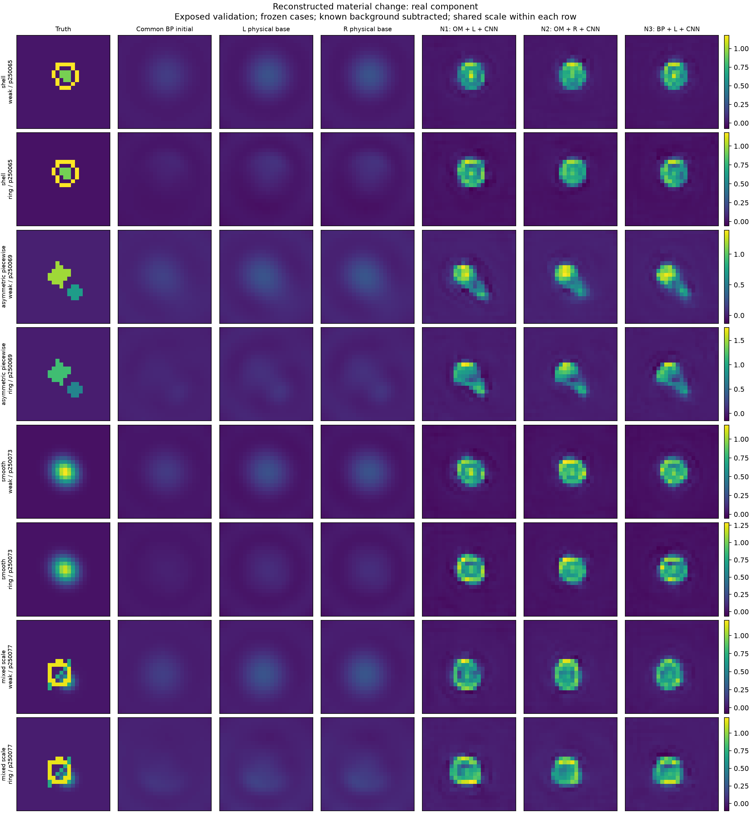
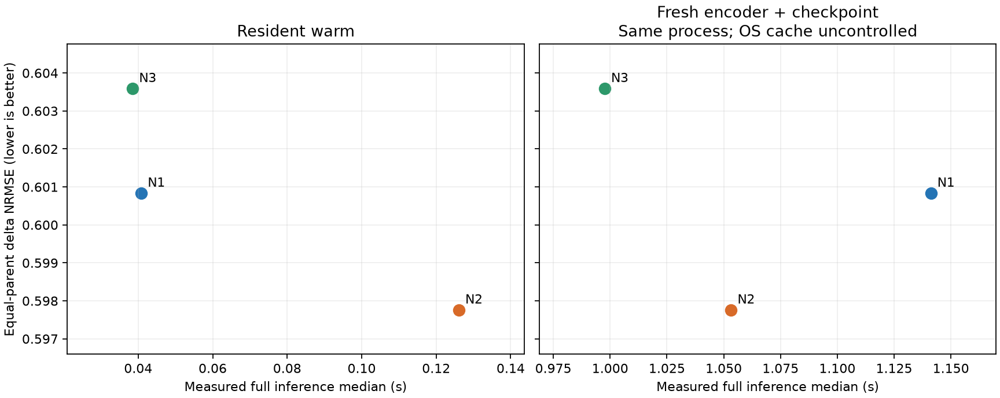

# A26 — OM Feedback-Guided Prior Completion

**Three real CNNs trained; current feedback extension: NO_GO.** Known-background 2D TM, 24×24 complex full-grid material, RTX4060 Laptop. No new labels and no locked ID/OOD opening.

The learned structural prior reduces complex-family material error by approximately 23–24% over its physical inputs. At matched 31,810 parameters and 2000 updates, explicit TASK_R32 feedback does not improve complex-family reconstruction over either matched control. Its complete warm inference is 3.274× slower than the faster control. These are exposed-development results, not an independent generalization claim.

| 配对（复杂三家族） | 改善 % | 区间下限 % | 区间上限 % |
| --- | --- | --- | --- |
| N2_vs_N1 | -0.22497 | -2.45492 | 2.01316 |
| N2_vs_N3 | -0.273442 | -1.61211 | 1.24648 |
| N1_vs_N3 | -0.207612 | -2.89103 | 2.39157 |
| N1_vs_BASE_N1 | 23.6612 | 18.4534 | 28.3248 |
| N2_vs_BASE_N2 | 23.4423 | 18.6957 | 28.2992 |
| N3_vs_BASE_N3 | 23.6931 | 18.9957 | 28.7902 |

- [完整中文研究报告](A26_RESEARCH_REPORT_ZH.md)
- [研究入口](A26_START_HERE.md)
- [Final scientific decision](A26_FINAL_DECISION.md) and [machine-readable gates](GATE_DECISION.json)
- [All case metrics](results/a26/evaluation/261009/PER_CASE_METRICS.csv), [parent metrics](results/a26/evaluation/261009/PER_PARENT_METRICS.csv), [physics diagnostics](results/a26/evaluation/261009/PHYSICS_DIAGNOSTICS.json)
- [Reproduce using public cached inputs](REPRODUCING_A26.md)
- [Frozen protocol](research/A26_FROZEN_PROTOCOL.md), [configuration](configs/a26/pilot.json), [source provenance](A26_SOURCE_MANIFEST.json)
- [Actual model/data/raw-evidence Release](https://github.com/migodam/a26-om-feedback-prior-completion/releases/tag/a26-v0.1.0)

The archived A24/A25 files remain unchanged as historical controls. Their previous results are not A26 evidence. Main source: A25 commit `59d8cc57c9da99ccb7978febc308193c43d6f3e5`. This repository does not publish unopened locked payloads or credentials. Physics identity, tests, material quality and deployment speed are separate judgments. No official SOM-Net superiority, arbitrary-complex-material recovery, sample-efficiency or 3D claim is made.
